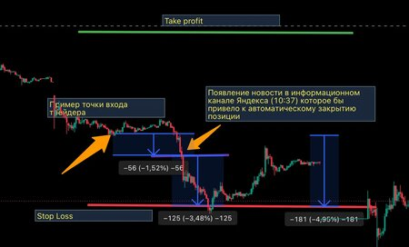
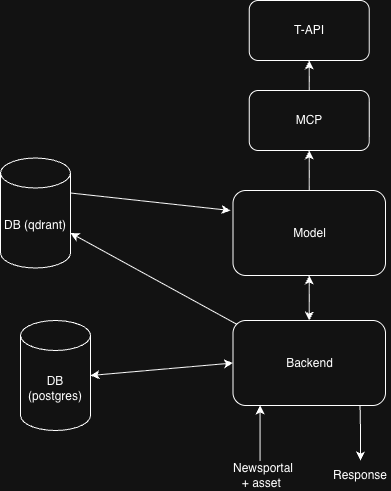
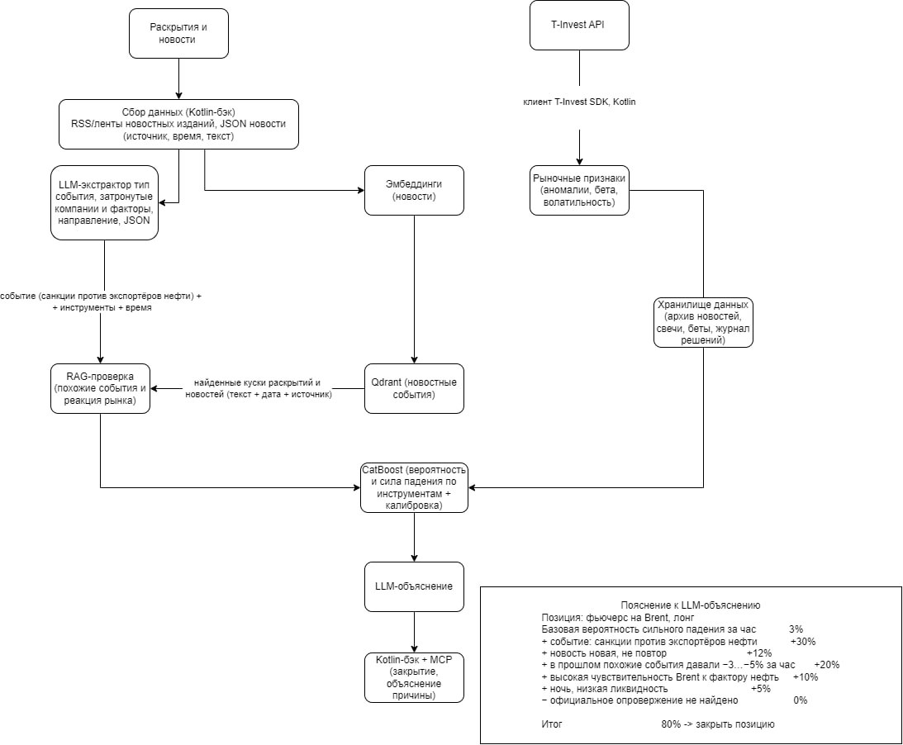

# Прототип ИИ-системы для защиты фьючерсных позиций от резких рыночных движений, вызванных новостными событиями.

## Идея

Система анализирует новости из различных источников, оценивает их потенциальное влияние на открытые позиции трейдера и при обнаружении критической угрозы может инициировать закрытие позиции до срабатывания Stop-Loss.

Пользователь самостоятельно включает защиту и задаёт допустимый уровень риска.

## Реализация

В текущей версии реализован простой backend-адаптер для взаимодействия с **T-Invest MCP Server**.

Планируемый сценарий работы:

1. Получение информации об открытых позициях через T-Invest MCP.
2. Сбор и анализ новостей с помощью ИИ.
3. Оценка риска для конкретных позиций.
4. Отправка уведомления или инициирование закрытия позиции.
5. Проверка результата и уведомление пользователя.

> На данный момент реализован только backend-адаптер. Полноценный анализ новостей и автоматическое закрытие позиций находятся на стадии концепции.

## Документация

Дополнительные материалы и иллюстрации проекта находятся в директории [`docs/`](./docs/).

### Обоснование полезности решения на примере падения акций известного бигтеха из-за новостей о потере инфраструктуры

### Архитектура

### Архитектура модели

